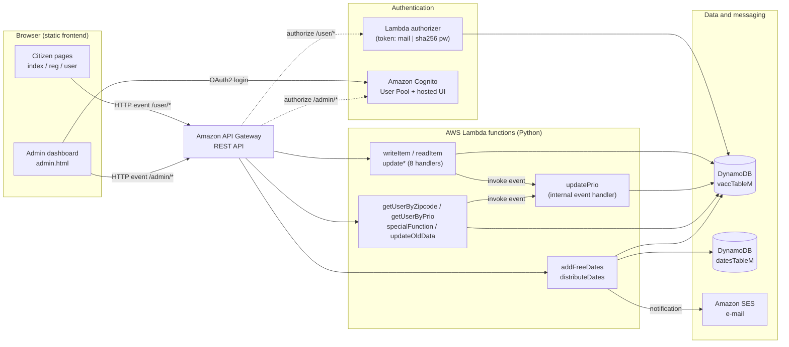
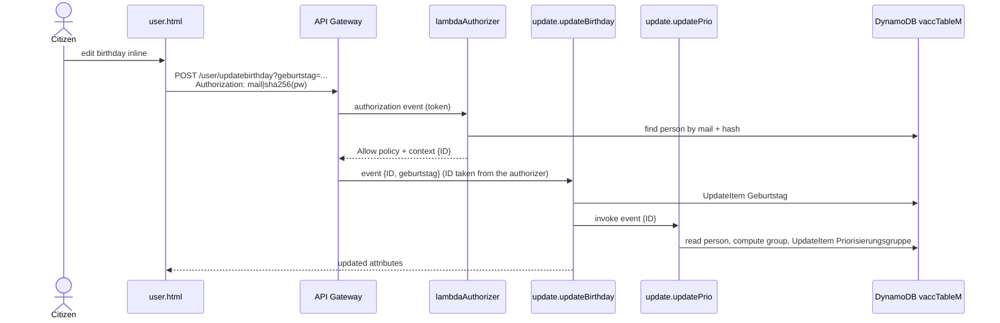
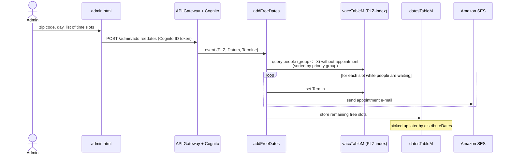

# Vaccination Priority System

A **serverless, event-driven web application on AWS** for organizing a vaccination campaign. Citizens register online and are placed in a priority group based on their age and risk factors. The health authority publishes vaccination slots per zip code, and the system assigns them to the people with the highest priority and notifies them by e-mail.


> University team project developed by a team of three students at the University of Bamberg. The user interface is in German.

---

## Table of contents

- [Features](#features)
- [Architecture](#architecture)
- [Event catalog](#event-catalog)
- [Key flows](#key-flows)
- [Prioritization rules](#prioritization-rules)
- [API reference](#api-reference)
- [Data model](#data-model)
- [Security model](#security-model)
- [Project structure](#project-structure)
- [Deployment](#deployment)
- [Limitations and possible improvements](#limitations-and-possible-improvements)
- [Team](#team)

---

## Features

**For citizens**
- Register with personal data, zip code (PLZ), critical-infrastructure job (*Systemrelevanz*) and pre-existing conditions (*Vorerkrankungen*)
- Log in, view the profile, priority group and assigned appointment
- Edit every field inline. The priority group is recalculated automatically after each change.

**For the health authority (admin)**
- Log in through the Amazon Cognito hosted UI
- List registrations by zip code or by priority group
- Publish vaccination slots for a zip code and day. They are assigned to the highest-priority people immediately, and each person receives an e-mail.
- Distribute stored free slots to the next *n* people in a zip code area
- Migrate legacy records to the current data model

---

## Architecture

The backend follows an **event-driven, serverless architecture**. There are no servers that run continuously. Each piece of business logic is a small, independent AWS Lambda function that runs only when an event arrives and scales automatically with the number of events. The whole stack is defined as code in [`backend/serverless.yml`](backend/serverless.yml) (Serverless Framework / CloudFormation).



**Why event-driven?**

- **Event sources trigger all logic.** Functions are wired to events in `serverless.yml`: HTTP requests through API Gateway, authorization events before every protected request and invocation events from other functions.
- **Reactions are chained.** A profile change is one event (`update*`). Its handler stores the change and then emits a follow-up event that invokes `updatePrio`, which recalculates the priority group. Publishing slots (`addFreeDates`) triggers bookings, and each booking triggers an e-mail notification through SES.
- **Functions are small and loosely coupled.** Each function has a single responsibility and its **own least-privilege IAM role** (`serverless-iam-roles-per-function`). For example, `readItem` may only call `dynamodb:GetItem` on the registrations table.
- **Everything is managed and pay-per-use.** Lambda, API Gateway and DynamoDB (on-demand billing) scale to zero when there are no events.

---

## Event catalog

| Event | Source | Handler | Reaction |
|-------|--------|---------|----------|
| Citizen signs up | `POST /user/writeitem` | `writeItem` | Calculate priority group, store registration |
| Request to `/user/*` | API Gateway (before the request) | `lambdaAuthorizer` | Validate token, return IAM policy + caller `ID` |
| Citizen opens profile | `POST /user/readitem` | `readItem` | Return the caller's own record |
| Citizen edits a field | `POST /user/update<field>` | `update.update*` (8 handlers) | Update field, **emit** `updatePrio` event |
| Priority recalculation | Lambda invocation | `update.updatePrio` | Recompute and store priority group |
| Admin publishes slots | `POST /admin/addfreedates` | `addFreeDates` | Book slots for top-priority people, **send e-mails**, store leftover slots |
| Admin distributes slots | `POST /admin/distributedates` | `distributeDates` | Book stored slots for the next *n* people, **send e-mails** |
| Admin migrates old data | `POST /admin/updateolddata` | `update.updateOldData` | Upgrade legacy records, **emit** `updatePrio` events |
| Admin queries | `POST /admin/getuserby*`, `/admin/specialfunction` | `getUserByZipcode`, `getUserByPrio`, `specialFunction` | Query via DynamoDB secondary indexes |

---

## Key flows

### Profile update and priority recalculation



### Appointment allocation



---

## Prioritization rules

The same rules are implemented in `writeItem` (on registration) and `updatePrio` (after every change):

| Priority group | Condition |
|:--------------:|-----------|
| **1** | Age 60 or older |
| **2** | Age 40–59, **or** age 18–39 with a critical-infrastructure job or pre-existing conditions |
| **3** | Age 18–39 |
| **-1** | Under 18 (not eligible) |

Groups 1–3 are ranked in ascending order: group 1 has the highest priority. Appointment queries use the `PLZ-index`, whose sort key is the priority group, so people are returned in priority order.

---

## API reference

All endpoints are `POST` requests. Update endpoints take their value as a query string parameter. API Gateway inserts this value unquoted into a JSON request template, so **string values must be sent in double quotes** (e.g. `?vorname="Max"`, URL-encoded). Booleans are sent as plain `true`/`false`. The base URL is printed by `serverless deploy` (`https://<api-id>.execute-api.<region>.amazonaws.com/<stage>`).

**Citizen API** (custom authorizer, header `Authorization: <mail>|<sha256(password)>`)

| Endpoint | Input | Description |
|----------|-------|-------------|
| `/user/writeitem` | registration form *(public, no auth)* | Sign up |
| `/user/readitem` | none (ID from token) | Get own profile |
| `/user/updatefirstname` | `?vorname="…"` | Update first name |
| `/user/updatelastname` | `?name="…"` | Update last name |
| `/user/updatemail` | `?mail="…"` | Update e-mail |
| `/user/updatebirthday` | `?geburtstag="dd-mm-yyyy"` | Update birthday |
| `/user/updatezipcode` | `?plz="…"` | Update zip code |
| `/user/updategender` | `?geschlecht="m\|w\|d"` | Update gender |
| `/user/updatesysrel` | `?systemrelevanz=true\|false` | Update critical-infrastructure flag |
| `/user/updatehealthpr` | `?healthPr=true\|false` | Update pre-existing-conditions flag |

**Admin API** (Cognito user pool authorizer, header `Authorization: <Cognito ID token>`)

| Endpoint | Body | Description |
|----------|------|-------------|
| `/admin/getuserbyzipcode` | `{"PLZ": "96047"}` | People in a zip code (group `<= 3`), by priority |
| `/admin/getuserbyprio` | `{"prio": 1}` | All people in a priority group |
| `/admin/specialfunction` | `{"PLZ": "96047", "prio": 2, "amount": 10}` | Oldest *n* people of a group in a zip code |
| `/admin/addfreedates` | `{"PLZ": "96047", "Datum": "2021-12-24", "Termine": ["09:00", "09:15"]}` | Publish and assign slots |
| `/admin/distributedates` | `{"PLZ": "96047", "n": 5}` | Distribute stored free slots |
| `/admin/updateolddata` | `{"plz": "96047", "n": 20}` | Migrate legacy records |

---

## Data model

**`vaccTableM`**: registrations (on-demand capacity)

| Key / index | Attributes | Used by |
|-------------|-----------|---------|
| Partition key | `ID` (number) | read / update / delete a person |
| GSI `PLZ-index` | `PLZ` (hash) + `Priorisierungsgruppe` (range) | people of a zip code, already sorted by priority |
| GSI `Prio-index` | `Priorisierungsgruppe` (hash) | people of a priority group |

Other attributes: `Name`, `Vorname`, `Mail`, `Geburtstag`, `Geschlecht`, `Systemrelevanz`, `Vorerkrankungen`, `Termin`, `Version`, `secret`.

**`datesTableM`**: free vaccination slots: `PLZ` (partition key), `Datum` (sort key), `Termine` (list of times).

---

## Security model

- **Citizens** authenticate with a token made of their e-mail and the SHA-256 hash of their password. The custom **Lambda authorizer** validates the token and returns an IAM policy that only allows `POST /user/*`. It also returns the person's `ID`. API Gateway request templates inject this `ID` into the event, so a citizen can only read and change **their own** record. The `ID` is never taken from client input.
- **Admins** authenticate through the **Cognito** hosted UI (OAuth2 authorization code flow). API Gateway validates the Cognito ID token for every `/admin/*` request.
- **Least privilege:** every Lambda has its own IAM role that is limited to the exact DynamoDB actions, indexes, SES identities and Lambda functions it needs.

---

## Project structure

```
.
├── backend/
│   ├── serverless.yml            # Infrastructure as code: functions, events, IAM, DynamoDB, Cognito
│   └── functions/
│       ├── writeItem.py          # Sign-up + initial priority calculation
│       ├── readItem.py           # Read own profile
│       ├── update.py             # 8 profile-update handlers, updatePrio, updateOldData
│       ├── lambdaAuthorizer.py   # Custom token authorizer for /user/*
│       ├── getUserByZipcode.py   # Admin: list by zip code
│       ├── getUserByPrio.py      # Admin: list by priority group
│       ├── specialFunction.py    # Admin: oldest n people of a group in a zip code
│       ├── addFreeDates.py       # Admin: publish + assign slots, send e-mails
│       ├── distributeDates.py    # Admin: distribute stored free slots, send e-mails
│       └── deleteItem.py         # Internal: delete a registration
└── frontend/
    ├── index.html                # Citizen login
    ├── reg.html                  # Citizen registration
    ├── user.html                 # Citizen profile (inline editing)
    ├── admin.html                # Admin dashboard
    ├── style.css
    └── js/
        ├── app.js                # Registration logic
        ├── utl.js                # UI helpers
        └── service/FetchService.js
```

---

## Deployment

### Backend

Prerequisites: an AWS account with configured credentials, Node.js and the [Serverless Framework](https://www.serverless.com/framework/docs) (`frameworkVersion: '2 || 3'`).

```bash
cd backend
serverless plugin install -n serverless-iam-roles-per-function
serverless deploy            # deploys to stage "dev" in eu-central-1
```

Before deploying to your own account:
- Update `provider.runtime`. The project was built for `python3.8`, which AWS Lambda has deprecated. The code uses only `boto3` and the standard library, so a current Python runtime should work.
- Set `custom.accountID` in `serverless.yml` to your AWS account ID.
- Verify a sender address in **Amazon SES** and use it as `Source` in `addFreeDates.py` and `distributeDates.py`. In the SES sandbox, recipient addresses must be verified too.
- Change the Cognito domain (`UserPoolDomain`) and the callback/logout URLs to values that fit your deployment.
- `update.py` invokes `DSG-Task3-M-dev-updatePrio`. Adjust the name if you deploy with another service name or stage.

### Frontend

The frontend is plain HTML/JavaScript and needs no build step. It was hosted as a static website behind Amazon CloudFront.

1. Replace the API Gateway base URL in `frontend/*.html` and `frontend/js/app.js` with the URL printed by `serverless deploy`.
2. In `admin.html`, `index.html` and `reg.html`, update the Cognito domain, client ID and redirect URI.
3. Upload the `frontend/` folder to an S3 bucket and serve it through CloudFront (or any static web host).

---

## Limitations and possible improvements

This project was built as a prototype for a university course. A production system would address the following points:

- **Asynchronous events:** follow-up events are synchronous Lambda invocations. Using DynamoDB Streams, Amazon EventBridge or SQS would decouple the producers from `updatePrio` and add retries and dead-letter queues.
- **Authentication:** citizens use a custom token (mail + unsalted SHA-256 hash) stored in a cookie. Moving citizens to Cognito as well, or using salted password hashing and short-lived tokens, would be more secure. The authorizer looks up users with a table `Scan`; a GSI on `Mail` would make this a `Query`.
- **Configuration:** API URLs, the sender e-mail address and the AWS account ID are hard-coded. They could be passed in as environment variables and stack outputs.
- **IDs:** registration IDs are derived from the timestamp. A UUID would guarantee uniqueness.
- **Testing and CI:** automated tests (e.g. with `moto`) and a deployment pipeline are not included.

---

## Team

Developed as a team project by three students at the University of Bamberg.
